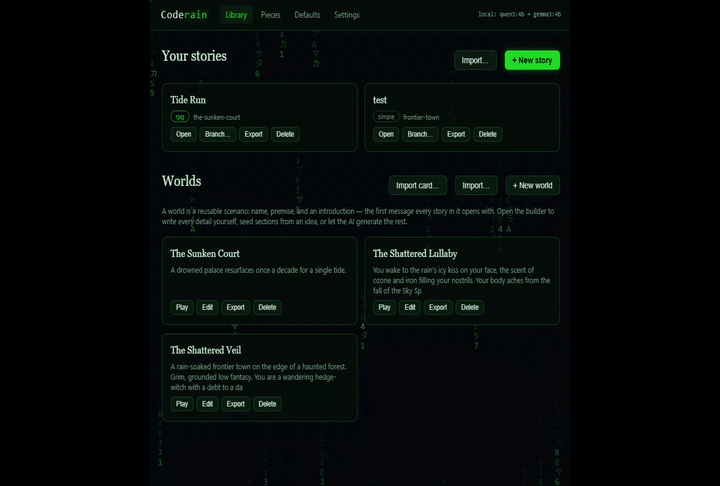

# Coderain

**A local, private AI storytelling engine — your worlds, your model, your memory.**

Coderain is an AI-Dungeon-style interactive-fiction engine that runs on **your**
machine against **your** model (local via Ollama, or any OpenAI-compatible cloud
key). No accounts, no subscription, no server reading your stories. It's built
around one idea most tools hide: **your memory should be yours** — plain Markdown
files you can read, edit, diff, and own.

Free and open source (MIT). If it saves you a subscription, [donations](#support)
keep it going — but everything is here, forever, for everyone.



---

## Why it's different

- **Markdown is the source of truth.** Every story is a folder of `.md` files —
  characters, locations, factions, items, threads, a running transcript, and
  tiered memory (recent turns → folded scenes → long arc + timeline + facts).
  Open them in any editor. No opaque database.
- **A real memory system, not a bigger context window.** Salience-ranked,
  alias-triggered lorebook activation; automatic summarization into scenes and an
  arc; optional semantic (vector) recall — all rebuildable from the Markdown.
- **A lore web.** Who holds what, who is tied to whom and which entries link to
  each other form one web you can see and edit ("Lore web..."). Optionally, when
  something comes into play the writer is also told about what is connected to
  it, in either direction, without ever giving away a secret.
- **Search of the story's own words.** Optionally, each turn finds passages from
  far back that match what you are doing and quotes them to the writer, so an
  exact line said long ago can come back. It runs locally in SQLite, by keyword,
  and by meaning when semantic recall is on.
- **A code validator between the model and the page.** An optional multi-brain
  "quad" pipeline (Planner → **deterministic code Validator** → Writer) means
  mechanics are checked by code, not hallucinated: engine-rolled dice, real
  inventory/gold/quests, an in-world clock that only moves forward.
- **Pay for the brains you need.** A pure-narrative story runs **single-brain**
  (one pass per turn) — consistency comes from the memory system, and the same
  pass still plans reveals, time, and quest state. Turn the **quad** pipeline on
  for RPG/tactical play, where a second pass resolves the mechanics *before* the
  prose so the narration can't contradict them. The Settings **Cost vs quality**
  dial (Economy / Balanced / Quality) sets this; the Planner runs on a slim
  planning context so even quad stays lean.
- **A story that plans ahead.** An optional rolling chapter outline plots a few
  chapters in advance and writes a fresh one each time a chapter's goal lands, so
  the arc keeps a shape instead of wandering. It's not another per-turn brain — it
  plans only at the memory-fold cadence, and you can view, edit, reorder, or
  regenerate the plan from the **Plan** panel.
- **Optional RPG campaign layer.** Stats, skill checks with fair engine-rolled
  dice, HP/mana/XP, inventory, a quest state machine, companions with mood +
  private side-chat — all toggleable; the core stays a clean narrative engine.
- **Bring your SillyTavern cards.** Import V1/V2/V3 character cards (PNG / JSON /
  charx) — the character, scenario, first message, and embedded lorebook become a
  ready-to-play world.
- **Local-first, BYO everything.** Ollama on your GPU, or paste a cloud key
  (DeepSeek, GLM, Claude, OpenRouter, …). Your key lives only on your machine.

## Install

**Desktop (Windows), zero setup:** download the latest `Coderain-win-x64.zip`
from [Releases](../../releases), unzip, run `Coderain.exe`. It opens in its own
window — no Python, no terminal. For local models, install
[Ollama](https://ollama.com/download) and pull a model — the in-app
**Settings → Local** guide walks you through it.

**From source (any OS)** — one command, no manual venv:

```bash
git clone https://github.com/Zwimy/coderain
cd coderain
python start.py         # Windows: double-click Coderain.bat  •  macOS/Linux: ./run.sh
```

The **first run creates a `.venv`, installs the requirements, and opens the web
app** in your browser (http://127.0.0.1:8377) — you only need Python 3.10+ on
your PATH. After that, `python start.py` just launches. Other modes:
`--cli` (terminal), `--no-browser`, `--port 8399`, `--gui` (the retro UI).

<details><summary>Prefer to manage the venv yourself?</summary>

```bash
python -m venv .venv && . .venv/Scripts/activate   # or .venv/bin/activate
pip install -r requirements.txt
python start.py                                    # or: python server.py
```
</details>

## Run local models (optional, free, private)

1. Install [Ollama](https://ollama.com/download).
2. `ollama pull qwen3:4b` (planner) and `ollama pull gemma3:4b` (writer).
3. Set `OLLAMA_CONTEXT_LENGTH=16384` and restart Ollama (its default 4k starves
   long stories).
4. In Coderain, pick your models. That's it — 100% offline.

Prefer a cloud model? Paste a key instead (DeepSeek/GLM are cheap and strong).

**Which local writer?** `gemma3:4b` is the default: about 11 seconds a turn on an
8 GB card. `llama3.1:8b` followed the story's ties and possessions ("who is her
brother", "who carries the key") more faithfully in our probe (16 of 17 questions
right against 11 to 13 for `gemma3:4b`; one story, one run) and takes about a
minute a turn on the same card. If you can wait, it is worth trying.

**Gemma 4 E4B** (`ollama pull hf.co/mradermacher/gemma-4-E4B-it-heretic-GGUF:Q4_K_M`,
about 5.5 GB, about 25 seconds a turn on the same card) is the model we now test
with. In long-story tests on an invented story (300 to 1,000 turns, a scripted
player) it kept its replies near 300 words and did not copy its own previous
reply, while `gemma3:4b` began copying its previous reply somewhere between turn
50 and turn 250 and ended up repeating itself in replies of a thousand words.
Gemma 4 E4B was weaker than `gemma3:4b` at using relationship facts (5 to 8 of 12
"who is her brother" questions right against 9 to 10) and repeated a secret it
was holding more readily. These are one or two runs each, and we tested a
community quantisation of the model, not Google's own release. The numbers are in
`docs/DECISIONS.md` (D-069 to D-071).

### Optional: the memory reader

A small local model can read each turn and keep a ledger of who looks like what and
who is wearing or carrying what, so a long story stops drifting ("her hair was raven,
now it is auburn"). It is off until you turn it on in `config.yaml`:

```yaml
canon:
  shadow: true
  model: llama3.1:8b     # the reader we recommend: it reads more precisely than gemma3:4b
  inject: preview        # start here: build the card every turn but send nothing
```

Run `ollama pull llama3.1:8b` first. On an 8 GB card the reader and the writer take
turns loading, so a turn is slower. With `inject: preview` you can read what the writer
would be told in `<save>/canon/card-last.txt` before you set `inject: true`. The
**Canon** button in the story shows what the reader holds about each person and lets
you say what is true or false: set a look (`Name: hair = raven`), or mark something
wrong, including a garment or an item it filed by mistake (`Name: outfit is not red
cloak`). Your corrections win over the story's own text and survive undo and retry.

**You don't have to read any of this first.** On first run Coderain checks
whether it can reach a model and, if not, opens a setup screen with both options
— it detects Ollama for you, or takes a key. You can change it later in
**Settings**.

## Tech

Python + FastAPI backend, a vanilla-JS single-page app, SSE streaming. The engine
is provider-agnostic (one OpenAI-compatible client). Over 100 test suites, all offline
(`python run_tests.py`). A retro Win2000 Tkinter UI (`gui.py`) survives as an
easter egg.

## Support

Coderain is free. If you'd like to chip in:

- ⭐ Star the repo — it genuinely helps.
- ☕ [Ko-fi](https://ko-fi.com/zwimy) — buy me a coffee.
- 💚 [GitHub Sponsors](https://github.com/sponsors/Zwimy)
- 🐛 Issues & PRs welcome — importing more chat/card formats, new lorebook
  behaviors, and translations are great first contributions.

## License

MIT — see [LICENSE](LICENSE). Do anything you want with it.
